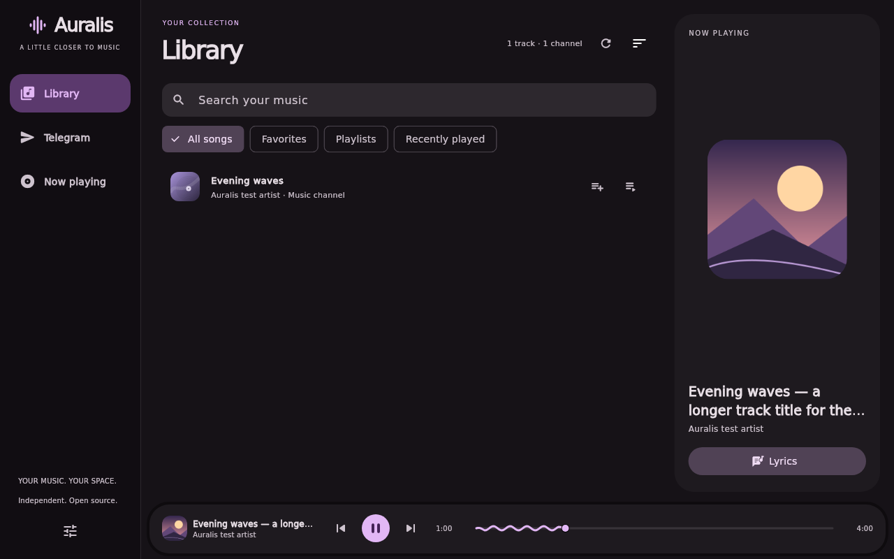
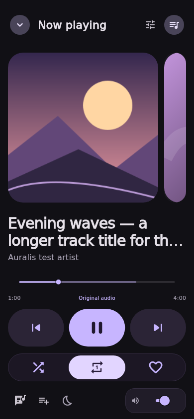
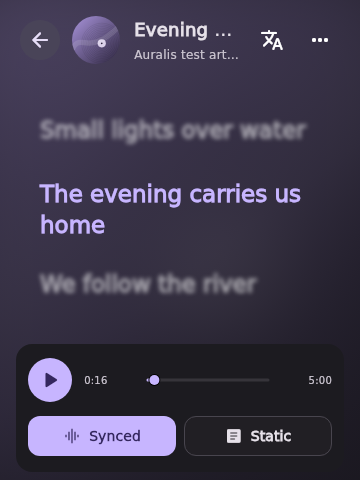
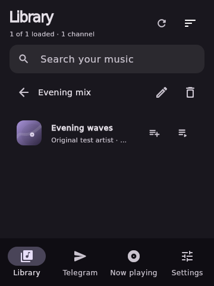
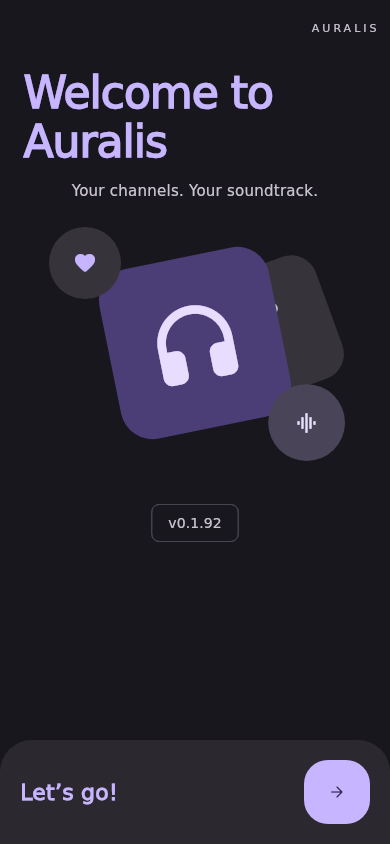
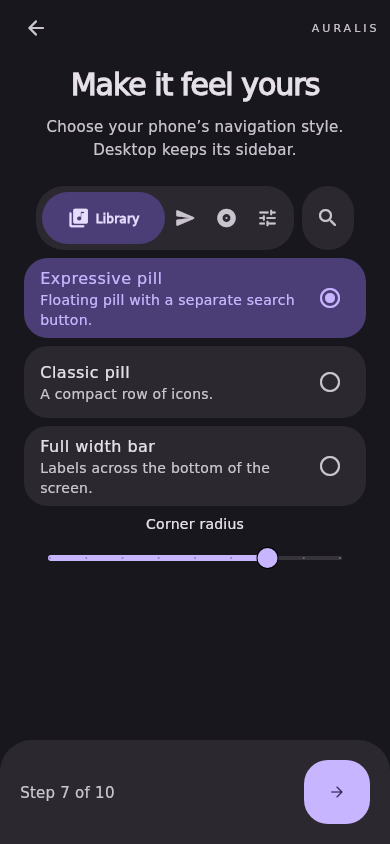
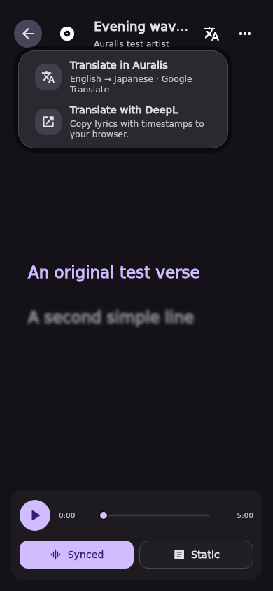

<div align="center">


**Your music. Your space.**

A compact music player for **Android and Windows**, built with Flutter.<br>
Bring music from your Telegram channels into one library, build playlists, and follow along with lyrics.

<p>
  <a href="https://github.com/Chowdhury-Siam/Auralis/releases/latest"></a>
  <a href="https://github.com/Chowdhury-Siam/Auralis"></a>
  <a href="LICENSE"></a>
  <br>
  <a href="https://flutter.dev"></a>
  <a href="https://dart.dev"></a>
  <a href="https://core.telegram.org/tdlib"></a>
</p>

[**Download Latest**](https://github.com/Chowdhury-Siam/Auralis/releases/latest) · [**Setup Guide**](#get-started) · [**Report a Bug**](https://github.com/Chowdhury-Siam/Auralis/issues) · [**Build from Source**](#development)

</div>

> [!TIP]
> **Sign in with your own Telegram account.** Select channels you already have access to, then open Library to browse their music together. Local music importing is not included.

---

## 🧭 Explore

- [Meet Auralis](#meet-auralis)
- [Features](#features)
- [Screenshots](#screenshots)
- [Get started](#get-started)
- [Library and collections](#library-and-collections)
- [Playback and lyrics](#playback-and-lyrics)
- [Stats, exports, and backups](#stats-exports-and-backups)
- [Settings and privacy](#settings-and-privacy)
- [Development](#development)
- [Publishing](#publishing)
- [Troubleshooting](#troubleshooting)
- [Project status](#project-status)
- [Developers](#developers)
- [License](#license)

---

<a id="meet-auralis"></a>

## ✨ Meet Auralis

Auralis brings music from your selected Telegram channels into a single, searchable library. Find a song, add it to your queue, save it to a playlist, or open the lyrics while it plays.

The charcoal and violet interface adapts from compact bottom navigation to a desktop sidebar. Album artwork, a wave seek bar, and a focused Now Playing view keep the music close without filling the screen with controls.

Playback uses **libmpv**, and Telegram connectivity uses **TDLib**. Auralis streams the original file bytes without re-encoding; the source file and your audio device determine the resulting quality.

---

<a id="features"></a>

## 💎 Your Music, in One Place

### 🎵 One Library from Your Channels

Select multiple Telegram channels, search by title, artist, or channel, and sort by post date, title, artist, or duration. Older audio posts load automatically, with progress and partial errors shown as the library grows.

### 💜 Favorites & Playlists

Keep favorites, create ordered playlists, and return to recently played music. Collections save locally between launches and can be included in a backup.

### 🎧 A Queue That Follows You

Add and reorder tracks, use Play next, shuffle upcoming songs, and repeat the queue or a single track. Seek or set a sleep timer. Android uses device volume buttons; desktop Up/Down keys adjust volume with an on-screen percentage. Shuffle toggles a visible selected state and restores upcoming order when switched off.

### 📝 Lyrics with the Music

Follow line-synced lyrics with the highlighted line sharp and all other lines softly blurred. Line advances retain a brief motion-blur transition; reduced motion skips that animation. Click a line to seek, or switch to Static for clear selectable lyrics. Lyrics load automatically when playback starts, preferring saved or embedded words before the configured online sources. In-app translation follows the selected Japanese–English direction; provider order is configurable in Settings. You can also import an `.lrc` file or paste lyrics.

### 🖼️ Artwork Where It Belongs

See Telegram covers, channel avatars, and supported embedded MP3, FLAC, and M4A artwork. Library Refresh saves available artwork and lyrics and reports their separate totals. Saved covers are kept automatically; damaged images are treated as missing and retried. The current cover and the next ten saved queue covers decode before use, including repeat wraparound. Tracks without an available image use original procedural artwork.

### 📊 Listening Stats

View compact totals, a seven-day chart, and Tracks/Artists ranking tabs. Long-press an activity bar for its exact date and listening time. Export CSV or JSON; Backup & Restore expands when needed.

### 💾 Backup & Restore

Back up stats, collections, selected channels, and preferences. Preview a restore before replacing saved data, with a local recovery copy kept for the previous state.

### Everyday details

- Responsive layouts for phones and desktop windows, with a reduced-motion preference.
- Android background playback with notification, lock-screen, and headset controls.
- Android audio interruption handling and pause on headphone removal.
- Desktop Up/Down volume keys, temporary volume feedback, and focused media-key controls.
- Windows update checks, checksum-verified downloads, and confirmed install/restart.
- Encrypted credential storage using Windows DPAPI or Android Keystore.

---

<a id="screenshots"></a>

## 🖼️ A Look Inside

<p align="center">
  
</p>

<table>
  <tr>
    <td align="center"><strong>Now Playing</strong></td>
    <td align="center"><strong>Lyrics</strong></td>
    <td align="center"><strong>Collections</strong></td>
  </tr>
  <tr>
    <td></td>
    <td></td>
    <td></td>
  </tr>
</table>

<p align="center"><sub>Automated Flutter test frames with synthetic tracks and original fixture artwork; these are not live Telegram account captures.</sub></p>

---

<a id="get-started"></a>

## 🚀 Get Started

### Download and install

Choose a matching asset from [the latest GitHub release](https://github.com/Chowdhury-Siam/Auralis/releases/latest). If an Android asset is not attached yet, check the successful **Android APK build** run's artifacts.

| Platform | Package | Installation |
| --- | --- | --- |
| **Android 7.0+** | ARM64 APK | Open the APK to install on a compatible phone. x86_64 builds are also available for compatible devices or emulators; no 32-bit APK is provided. |
| **Windows x64** | `auralis-<version>-windows-x64-setup.exe` | Run the custom per-user installer; choose an install location and optional desktop shortcut. The Microsoft Visual C++ 2015–2022 x64 runtime is required. |
| **Windows portable** | Windows x64 release ZIP | Extract the complete package and launch `auralis.exe`; keep its DLLs and data folders together. |

Now Playing artwork supports left/right swipes and mouse-wheel track changes. Timed lyric intros and instrumental gaps use blurred text with a gentle music animation.

The Windows installer uses the Yutaka-style dark setup layout with Auralis branding, progress and automatic app opening/installer closing after one Install click. See the [installer guide](docs/INSTALLER.md) for build and verification details.

Android APKs now always use optimized release mode. Run **Set up Android signing** once to generate and retain a signing identity automatically; later builds reuse it. APKs labelled **development-release** use a temporary development signature. See [signing and upgrades](docs/ANDROID.md#signing-and-upgrades).

### First launch

A fresh install opens an illustrated setup flow for Telegram, optional Android device settings, backup restore, lyrics, artwork, library layout and navigation. You can skip optional steps and reopen **Settings → General → Set up Auralis** later. Existing installations keep their current library and go straight to the app. Appearance choices remain available under **Settings → Appearance**.

| Welcome | Navigation | Translation menu |
| --- | --- | --- |
|  |  |  |


1. Open **Telegram** in Auralis. Release builds configured with the application's Telegram credentials do not ask for an API ID or API hash.
2. Choose your country/calling code and enter your phone number, or paste a full international number beginning with `+`. Enter the Telegram login code and two-step password if requested. The code page shows the destination number; use **Change number** to correct it and request a replacement code.
3. Select one or more channels and choose **Open Library**.
4. Wait for the selected channels' audio posts to load, then choose a track to play.

Maintainers must set the two [Telegram build secrets](docs/TELEGRAM_BUILD.md) before building releases. Local/PR builds without application credentials retain manual API setup using an application registered at [my.telegram.org](https://my.telegram.org).

Use **Load more** in Telegram to discover more accessible channels and **Refresh** in Library to scan for new music or retry partial failures. Refresh caches only missing artwork or lyrics and reuses valid saved items, including after restart. Auralis respects your account's existing channel access; it does not join channels automatically.

---

<a id="library-and-collections"></a>

## 🎼 Library and Collections

| View | What it holds |
| --- | --- |
| **All songs** | Audio from the currently selected Telegram channels |
| **Favorites** | Tracks you have marked with the heart action |
| **Playlists** | Named, ordered collections you can create, rename, and delete |
| **Recently played** | The last 100 unique successfully opened tracks |

Track/channel counts and icon-only Refresh/Sort controls sit in the Library header. On narrow screens, the counts appear beneath the title. Choose channels in Telegram; listening stats remain in the full Settings page. Phone navigation has Library, Telegram, Now playing and Settings; the standalone Play Queue page is removed.

Use a track's actions to favorite it, play it next, or add it to a playlist. Library sorting leaves saved playlist order unchanged. Deleting a playlist removes the collection, not files from Telegram.

Saved collections hold channel/message references. To play those tracks later, sign into the appropriate account, select the source channels, and load their messages. Optional private multi-device sync shares these collection references; the playback queue remains session-only.

See the [collection guide](docs/GUIDE.md#favorites-playlists-and-recent-music) for limits and unavailable-track behavior.

---

<a id="playback-and-lyrics"></a>

## 🎧 Playback and Lyrics

Open **Now Playing** from navigation or the floating player’s artwork/title. The player shows an Up Next preview where space allows.

| Control | Behavior |
| --- | --- |
| **Repeat** | Cycles Off → Queue → One track |
| **Play next** | Inserts after the current queue entry without interrupting it |
| **Sleep timer** | Pauses after 15, 30, 45, 60, or 90 minutes, or at the end of the track |
| **Wave seek bar** | Seeks through the song; its wave is decorative, not an audio waveform |
| **Lyrics** | Opens synced or static text while keeping playback controls available |

The bottom player floats above the page, showing content through its margins and behind sideways movement. Releasing a drag springs it back while music continues. Desktop layouts include the song artwork. Repeat and sleep controls are on Now Playing; Android volume uses hardware buttons and desktop volume uses Up/Down keys.

Embedded lyrics load when supported tags are available. Use **Lyrics options** to retry reading the music file, import `.lrc`, or paste text. If saved or embedded lyrics are missing, automatic lookup uses the source order in **Settings → Lyrics & artwork → Lyrics & translation**. Defaults are LRCLIB exact/search then lyrics.ovh; either source can be first and the fallback can be disabled. **Find lyrics** retries the lookup. Back and the single options menu are at the top; the source footer is removed. **Follow song** returns to automatic scrolling after you browse elsewhere.

Favorites, playlists, listening statistics, recent music, channels and shared preferences can sync across Android and Windows through your own Cloudflare Worker and Turso database. Open Settings → Data & sync → Account & sync to deploy, sign in with a username, switch accounts or recover access. Owner credentials enable automatic updates when an app bundles a newer Worker. See [multi-device sync setup](docs/SYNC.md). Artwork, original lyrics and translations have an account-scoped device cache and are excluded from backups. In-app translation runs automatically by default; choose Japanese → English or English → Japanese and Google Translate/MyMemory provider order in Settings. DeepL’s website option remains available from Lyrics. Word-level karaoke is not included.

See the [lyrics guide](docs/GUIDE.md#now-playing-lyrics) and [audio-quality notes](docs/GUIDE.md#streaming-audio-quality).

---

<a id="stats-exports-and-backups"></a>

## 💾 Stats, Exports, and Backups

| Task | Where to go |
| --- | --- |
| View listening time, rankings, and daily activity | **Settings → Data & sync → Listening stats** |
| Export stats as CSV or JSON | **Listening stats → Export CSV / Export JSON** |
| Create or restore a backup | **Settings → Data & sync → Backup & Restore** |
| Recover the data replaced by the last restore | **Restore recovery copy** in the backup section |

A backup includes listening stats, favorites, playlists, recent music, channel selections, and preferences. **Include Telegram account** is enabled when connected: it adds your Telegram session, API details and database key inside a password-encrypted backup. Music files, artwork, lyrics, the queue and sleep timers are excluded.

Restoring previews the backup, then **replaces** saved local data and clears playback after confirmation. A recovery copy of the previous settings is saved first. Account backups require your backup password to restore; the session is re-encrypted for the destination device. The restore preview explicitly reports whether Telegram sign-in is included. Older settings-only JSON backups remain supported, but cannot restore an account; create a password-protected backup with **Include Telegram account** enabled on the signed-in device. Telegram may require a new login if a restored session has expired or been revoked.

See the [backup guide](docs/GUIDE.md#listening-stats-export-and-backups) for validation, recovery, and stats counting.

---

<a id="settings-and-privacy"></a>

## ⚙️ Settings and Privacy

| Setting or action | Purpose |
| --- | --- |
| **General / Appearance** | Reopen setup, choose compact library navigation, phone navigation style and corner radius |
| **Lyrics & artwork → Lyrics & translation** | Automatic lookup/translation, direction, and primary/fallback providers |
| **Data & sync → Listening stats** | Review listening activity and export data |
| **Data & sync → Backup & Restore** | Save and recover your Telegram account, collections, stats, and preferences |
| **App updates** | Check stable releases and choose whether to install |
| **Privacy & security → Sign out of Telegram** | Stop playback, clear queue/channel selections, and forget saved API credentials after successful logout |

API credentials and the TDLib database key are encrypted with **Windows DPAPI** or **Android Keystore**. Login codes and two-step verification passwords are not saved by Auralis. Android's Windows installer/update controls are disabled; upgrade by installing an APK signed with the same key.

Current audio uses temporary playback buffering. Extracted artwork and lyrics remain in the device cache; artwork is kept automatically. Logout does not promise secure erasure of cached media or backups.

Artwork uses Telegram or embedded metadata. Automatic lookup contacts the selected lyric sources during playback if saved/embedded lyrics are unavailable; only the displayed song title, artist and duration are sent, with no Telegram credentials or message/file IDs. Automatic in-app translation sends original lyric text to the selected translators. Android media controls receive the current cover and use the monochrome Auralis logo. Optional multi-device sync shares collection/listening metadata and can include your linked Telegram account. Its application connection values are encrypted in your private Worker; new devices require Telegram device approval. Telegram auth keys, session databases and music stay on their own devices. See the [storage notes](docs/GUIDE.md#storage-and-architecture).

---

<a id="development"></a>

## 🛠️ Development

Use **Flutter 3.47.1 / Dart 3.13.1**, matching the workflows. Keep the vendored `third_party/media_kit` runtime and `pubspec.lock` with the source.

```bash
git clone https://github.com/Chowdhury-Siam/Auralis.git
cd Auralis
flutter pub get --enforce-lockfile
flutter analyze --no-pub --fatal-infos
flutter test --no-pub --reporter expanded
```

| Target | Additional requirements | Build guide |
| --- | --- | --- |
| **Windows x64** | Visual Studio 2022 C++ desktop tools, Windows SDK, CMake, PowerShell 7.4+, and a TDLib native build | [Windows dependencies and build](docs/GUIDE.md#dependencies-and-build) |
| **Android** | Java 17, Android SDK 36, build tools 36.0.0, NDK 28.2.13676358, and an ABI-matched TDLib build | [Android local build](docs/ANDROID.md#local-build-on-linux) |

TDLib must be built before running a native app; `flutter pub get` alone does not provide it. The first native build can take substantial time and disk space. GitHub Actions reuses compatible native/dependency caches while continuing to run checks and final packaging.

---

<a id="publishing"></a>

## 📦 Publishing

GitHub Actions builds Android and Windows independently. A separate **Publish Auralis release** workflow waits for successful artifacts from the same trusted `main` commit before publishing the APK, Windows ZIP and custom EXE installer.

- Existing APK verification, native checks, persistent signing setup and Windows installer checks are retained.
- Optional Android x64 artifacts are attached when available for that same commit.
- A separate cleanup action removes green runs after publishing and failures after a minimum ten-minute retention period. It keeps active runs and artifacts still needed for publication.
- `CHANGELOG.md` generates matching GitHub and bundled app release notes. Settings has **What’s new**, installed updates show their changes once, and update notices include **What changed**.
- Both Android and Windows check for new stable updates automatically when enabled. Android can download a verified APK automatically; tap Install update to start installation. Android 12+ requests a self-update without further confirmation where allowed, with a system prompt as fallback. There is no Play Store publishing flow.
- Pull requests and other branches build artifacts without publishing. Published files/tags are not overwritten.

See [build/publish/cleanup and release notes](docs/RELEASE_PIPELINE.md), [sync setup](docs/SYNC.md), [Android signing](docs/ANDROID.md), and [third-party notices](THIRD_PARTY_NOTICES.md).

---

<a id="troubleshooting"></a>

## 🩺 Troubleshooting

| Problem | First check |
| --- | --- |
| Library is empty | Sign in, select accessible channels, and wait for audio indexing; try Refresh |
| A saved playlist track will not play | Select its source channel and reload its messages using the appropriate account |
| Cover or embedded lyrics are missing | The file may lack supported tags, or metadata may not be buffered yet; retry after more of the track downloads |
| Lyrics lookup finds no match | Check title/artist metadata, import `.lrc`, or paste lyrics |
| Seeking into uncached music buffers | The new position fetches its own byte range; update older versions that block new seeks behind abandoned requests |
| Android APK will not update | Confirm the same app ID and signing key; back up data before uninstalling a development build |
| Windows portable app cannot start | Keep the complete extracted folder and install the Visual C++ x64 runtime |
| A second instance cannot open Telegram | Close the first instance; a session lock protects the account database |
| An old Windows installation cannot apply an update | Install the latest setup manually; see [updater recovery](docs/UPDATES.md#recovery-from-the-v013-updater-failure) |

When [reporting a bug](https://github.com/Chowdhury-Siam/Auralis/issues), include your platform, app version, steps, and expected result. Remove credentials, phone numbers, login codes, session files, and private channel details from attachments.

---

<a id="project-status"></a>

## 🚧 Project Status

Auralis is under active development. This archive's source version is **0.1.108+109**, including [multi-device sync](docs/SYNC.md), [separate build/publish/cleanup actions](docs/RELEASE_PIPELINE.md), and matching in-app/GitHub release notes; that is not a claim about the latest published release.

Automated tests cover UI layouts, player/queue behavior, storage, metadata readers, and simulated Telegram responses. Existing native smoke and CI results are recorded in [VERIFICATION.md](docs/VERIFICATION.md). **Live account authentication, real Telegram music playback, Android device behavior, and fresh-machine installation remain unverified in that record.**

Current limits include no local music importer, equalizer, crossfade, persistent queue, cloud playlist sync, a standalone camera QR scanner, or automatic cache eviction. Windows global media controls and tray mode are not included. Native dependency licensing/source review and hardware, accessibility, and performance checks remain outstanding before claiming production readiness.

---

<a id="developers"></a>

## 👩‍💻 Developers

### Project map

| Path | Responsibility |
| --- | --- |
| `lib/app.dart` | Responsive navigation, Library, collections, player screens, and Telegram forms |
| `lib/player.dart` | Native audio backend, queue, and playback state |
| `lib/lyrics.dart` / `lib/lyrics_view.dart` | Lyrics loading, parsing, and display |
| `lib/telegram/` | TDLib transport, channel indexing, metadata extraction, and streaming proxy |
| `lib/storage.dart` | Settings and platform credential storage |
| `lib/updater.dart` / `lib/update_widgets.dart` | Windows stable-release updates |
| `android/` / `windows/` | Platform runners and integrations |
| `third_party/media_kit/` | Vendored playback runtime and documented patches |
| `test/` / `tool/` | Regression tests, native builds, verification, and packaging |
| `.github/workflows/` | Platform CI and release publishing |
| `docs/` | Guides, screenshots, audits, and verification history |

For changes, describe the affected flow and include relevant verification. Preserve collections, preferences, and account data across upgrades, and keep private credentials and generated native binaries out of Git.

---

<a id="license"></a>

## 📜 License

Original Auralis application code and procedural artwork are licensed under **AGPL-3.0-or-later**, copyright 2026 Auralis contributors. See [LICENSE](LICENSE).

Auralis is independently authored. [mpvRx](https://github.com/Riteshp2001/mpvRx) and [PixelPlayer](https://github.com/PixelPlayerHQ/PixelPlayer) are design/feature references; their application code, branding, screenshots, and assets are not bundled. Auralis is not affiliated with those projects or Telegram.

Third-party libraries retain their own licenses, including Flutter's generated host code and the vendored playback runtime. See [THIRD_PARTY_NOTICES.md](THIRD_PARTY_NOTICES.md) and the [upstream audit](docs/UPSTREAM_AUDIT.md) for notices, corresponding-source obligations, and outstanding native distribution review.

<p align="center"><sub>Your music. Your space.</sub></p>


Android 0.1.52 uses the package ID `com.auralis.siam` and includes automatic
update checks/downloads with user-initiated Android self-updates. This package needs
one manual install because the ID changed. Keep your existing app until your
available backups have been restored. See [Android setup and migration](docs/ANDROID.md)
for signing, updates, and unreadable Telegram credential recovery.

### Playback storage

Telegram audio is temporary: its local copy is removed when switching tracks, stopping playback or exiting normally. The current track can use disk buffering for playback and seeking. On an idle startup connection, Auralis clears audio/document cache left by older versions, while preserving images, the account database and lyric caches. Metadata-only audio fragments are removed after artwork or lyrics have been extracted.
