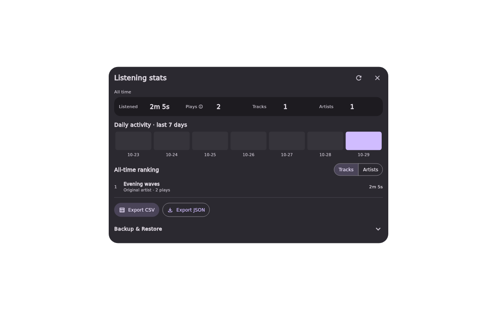
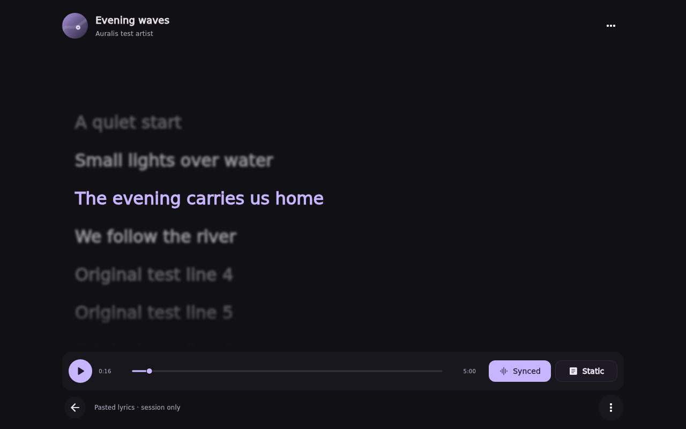
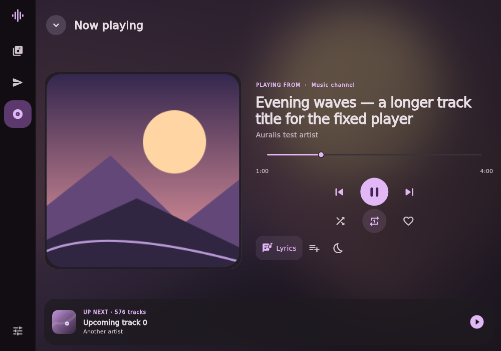
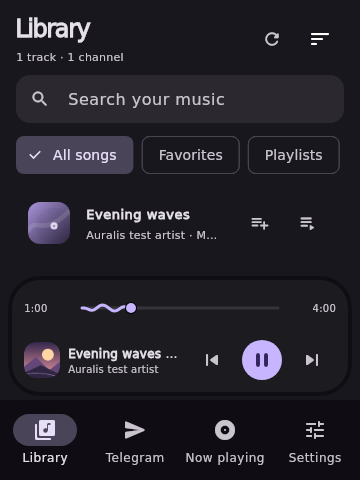
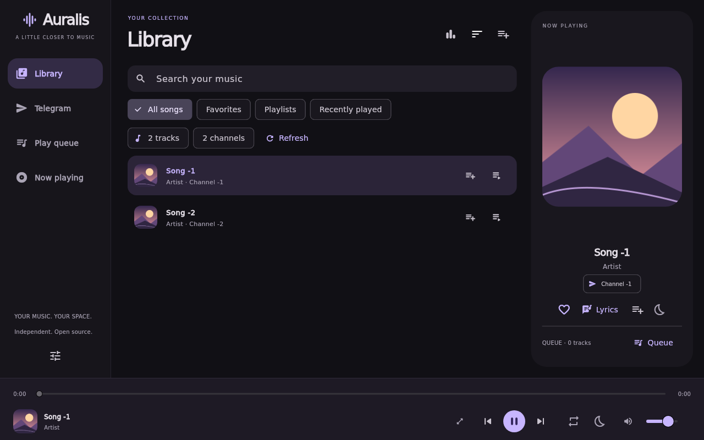

# Auralis Guide

Detailed playback, collection, storage, and build notes. For downloads and first launch, see the [project README](../README.md). Verification history is in [VERIFICATION.md](VERIFICATION.md).

## Logout and another account

Use **Settings → Sign out of Telegram**. Playback stops and the queue clears. When Telegram accepts logout, Auralis removes the API ID/hash from its encrypted vault and clears selected channels. The sign-in page shows progress until TDLib reports its closed state, then allows a fresh sign-in using the configured build identity and the usual phone/code/2FA steps. Local builds without application credentials instead display blank API ID/hash fields. The playback proxy follows the new client rather than keeping a closed connection. A normal app restart while signed in still retains your API configuration/session; explicit logout is what forgets it.

The database encryption key is retained, and Auralis does not recursively delete application-data folders. TDLib handles its own [logout cleanup](https://core.telegram.org/tdlib/docs/classtd_1_1td__api_1_1log_out.html). If Telegram rejects logout, the existing API configuration and channel selection stay intact and an error is shown. A failure to clear the credential vault is reported; retry connecting once storage is writable. Manual builds can re-enter API details to replace their saved configuration. Live switching between two real accounts and installation remain unverified.

## Favorites, playlists and recent music

Use the **All songs**, **Favorites**, **Playlists** and **Recently played** chips in Library. Track actions use the playlist/play icon beside the existing queue-add button: favorite/unfavorite, Play next, or Add to playlist. Now Playing also has a favorite button and Add to playlist shortcut. Favorites persist locally. Recent music records the last 100 unique successfully opened tracks, newest first; Clear history removes those references.

Create a playlist in Library → Playlists or while adding a track. Open a playlist and click a track to play its saved order. Rename and Delete are explicit buttons; track actions inside a playlist can remove that entry. Duplicate entries are ignored. Names are trimmed, case-insensitively unique and limited to 60 characters. There are limits of 100 playlists, 5000 tracks per playlist and 10000 favorites. Saved playlists keep their order; Library sort does not reorder them or Recent music. Delete removes the playlist only, never the Telegram files.

These are local collections, retained across sign-out and app restarts. They store message IDs and playlist names rather than native file IDs, artwork, credentials or audio copies. A saved track is playable only when its source channel is selected and its message appears in the loaded Library. Missing/inaccessible messages stay referenced but are not playable; choose the appropriate channels and refresh. The loaded/saved count is visible in larger windows. Optional multi-device sync shares playlist references and other library data through your private Auralis service; see [SYNC.md](SYNC.md). Downloaded playlist audio and queue restoration are not implemented.

## Repeat and sleep timer

The repeat button cycles **Off → Queue → One track → Off** and remembers the choice. Repeat one restarts a completed track; pressing Next still advances manually. Play next inserts immediately after the current queue entry without interrupting playback or changing which duplicate entry is active.

Open the moon icon in Now Playing or the playback bar. Choose **15, 30, 45, 60 or 90 minutes**, or **End of current track**. The active icon is highlighted and the dialog shows the pause time. Cancel timer removes it. Expiry pauses playback without clearing the queue or resuming already paused audio. End-of-track sleep takes priority over repeat. Clearing the queue or shutting down cancels the timer; it is not restored after restart and cannot wake a sleeping/closed PC.

The Library header shows compact track/channel counts with icon-only Refresh and Sort controls. Narrow windows and enlarged text place counts beneath the title; the full value remains available as a tooltip. The former bordered summary card below the collection filters has been removed. Refresh rescans selected channels and retries artwork when Telegram is connected and the Library is not busy. Recently played still offers Clear history alongside the collection choices.

## Listening stats, export and backups

Open **Settings → Listening stats** for total listening time, qualified plays, tracks/artists heard, top ten tracks/artists by listening time and daily activity for the last seven local calendar days. Stats start with this version; earlier recent history is not estimated. A play qualifies after 30 seconds or half the track duration, whichever is shorter, once per playback session. Repeat/replay starts a new session. Time is sampled from actual playback advancement, bounded by elapsed active time; pauses, buffering, app seeks and gaps longer than five seconds are excluded. Captured stats labels are limited to 1000 characters. Snapshots refresh on demand. Data is saved about every 30 seconds of playback events and on pause, track changes, export and orderly shutdown; an abrupt crash may lose the latest unsaved samples.

**Export CSV** writes UTF-8 spreadsheet data with separate track/day rows, listening seconds and qualified play counts. **Export JSON** preserves the complete stats structure. These exports contain stats only; use **Create backup** for a restorable snapshot. Track and day rows are alternate aggregations of the same time, so do not sum them together. Track titles, artist names and channel names are included in exports/backups; choose where to save them.

Open **Settings → Backup & Restore** directly, or scroll below the stats exports. A backup includes listening stats, favorites, ordered playlists, recent music, channel selections and preferences. When connected, **Include Telegram account** defaults on. It adds the authenticated TDLib database, API ID/hash and database encryption key. Choose and confirm a backup password of at least ten characters; it is never saved by Auralis. Keep that password: without it the account backup cannot be unlocked. Music files, artwork, lyrics, the queue and sleep timer are excluded.

Account backups use AES-256-GCM with a random nonce and salt, with a 256-bit key derived by PBKDF2-HMAC-SHA256 (600,000 iterations). Encryption/decryption runs off the UI isolate. Playback pauses and Telegram briefly closes its database before snapshotting, then reconnects without signing out. The closed database is limited to 32 MiB and 2,048 files; the complete JSON file is limited to 64 MiB. Larger databases report an error rather than silently omitting the sign-in. Disable the account option for a settings-only version-1 JSON backup, which retains its SHA-256 integrity check and is unencrypted.

**Restore backup** unlocks and validates the whole file before showing a confirmation. Account restore replaces the local sign-in and settings, re-protects credentials with the destination's Windows DPAPI or Android Keystore, and reconnects Telegram. No login code or Telegram two-factor password is stored. A revoked/expired Telegram session can still require a fresh login; do not rely on cloning one session for simultaneous use on multiple devices. The preview and completion message explicitly distinguish settings-only files from account backups. Old version-1 backups cannot recreate a Telegram sign-in: if restore did not ask for your backup password, connect Telegram manually or create a new password-protected account backup on the signed-in device. The account switch follows Telegram becoming ready while the dialog is open, unless you explicitly changed it.

Restore stops playback and clears the queue. The previous settings are saved first as `auralis-before-restore.json` beside the app settings. **Restore recovery copy** recovers settings only, preserving the currently active Telegram account. Each successful restore replaces that settings recovery slot. Account restore can replace an unreadable local credential vault without first decrypting it. Account database/vault changes are rolled back if writing credentials or restoring settings fails; rollback restores the exact original device-protected bytes. Telegram initialization is awaited across overlapping authorization events, and a failed startup closes that client so a retry uses a fresh one. A reconnect error is shown separately from successful settings/session installation; the app never treats installation alone as a confirmed Telegram login. A failed filesystem rollback leaves its operation-specific `telegram/restore-*` directory with the previous encrypted database and device-protected vault for recovery; it does not delete media caches. A sudden power loss during replacement still requires checking that recovery directory. Neither an account backup nor a settings recovery copy revokes the Telegram session it contains.



## Now Playing lyrics

Open **Now Playing → Lyrics**, or click Lyrics in the side panel. The song header keeps its cover/title/artist, the current line is large, highlighted and sharp, and every other line is softly blurred while a highlight is active. Synced lyrics follow playback and support clicking a line to seek. Scroll with the mouse to read elsewhere; **Follow song** resumes tracking. Static mode displays selectable text without timestamps. The immersive lyrics page includes play/pause and wave seeking. The top back arrow returns to the normal player. Use Android volume buttons or desktop Up/Down keys for volume. One options menu remains at the top; there is no bottom source footer. Automatic line advances use a brief vertical motion blur that clears when scrolling settles. Manual browsing stops the scrolling motion blur; the highlighted line remains sharp and surrounding lines keep their focus blur. Reduced motion uses instant scrolling without the transition effect, while retaining the same steady focus blur. Before the first timestamp and during blank timed gaps, all lines are blurred and a small decorative music pulse is shown. The pulse pauses with playback and respects reduced motion. Static mode is always unblurred. Layouts and screenshots are tested at 1280×800 and 360×480.

Saved and embedded lyrics are read automatically as playback starts, and when opening this page: MP3 ID3v2.2–2.4 USLT/ULT, millisecond SYLT/SLT and custom LYRICS/UNSYNCEDLYRICS/SYNCEDLYRICS text frames; FLAC Vorbis comment fields with those names; M4A/MP4 ©lyr atoms (UTF-8/UTF-16). LRC timestamps inside text tags enable Synced mode; plain tags use Static mode. Cached/pasted lyrics take precedence. **Lyrics options → Read lyrics from music file** retries extraction. Metadata reads share the artwork reader’s 4 MiB total budget and 20-second TDLib deadline. While streaming, only already buffered ranges are read so metadata extraction cannot move the playback download. If a needed range is not buffered, retry once it is downloaded. Compressed/encrypted ID3 frames, MPEG-frame SYLT timestamps, Ogg/Opus/WMA tags and automatic sidecar discovery is not supported; use Import .lrc file to choose a sidecar manually. No music is uploaded to a lyrics service.

If saved or embedded words are unavailable, playback automatically looks up lyrics using **Settings → Lyrics & translation**. Choose LRCLIB (exact lookup plus matched search) or lyrics.ovh as the first source, and choose or disable the fallback. **Find lyrics online** explicitly retries. Only the displayed title/artist/duration are sent; no Telegram credentials or message/file IDs are sent. Successful original lyrics and provider attribution persist in the account-scoped device cache, with bounded memory use. Imports and newer account/song requests take precedence over late responses. Plain-only results use Static mode; instrumental and missing/error states remain distinct.

Use **Import .lrc file** in the empty state or **Lyrics options → Import .lrc file** to attach a local lyrics file to the current song. Windows uses the native .lrc picker; Android uses the system document picker, which may show all file types so providers can expose .lrc files. UTF-8 (with or without BOM) and UTF-16 LE/BE with BOM are supported. Files are limited to 256 KiB and 2000 lyric entries. Existing LRC offsets, repeated timestamps and translations work as usual; plain text uses Static mode. Import overrides the current session’s lyrics, with no audio/tag modification or upload. Cancelled/invalid imports preserve the previous lyrics, and a selection made for a song that has changed is discarded. Imported lyrics are kept in the bounded memory cache and device lyric cache, not in backups.

Use **Paste lyrics** for plain text or line-timed LRC. It supports fractional seconds, repeated timestamps, offset tags and simultaneous translation lines. Lyrics are limited to 256 KiB per field / 2000 timed entries, with HTTP responses capped at 512 KiB and a 20-second overall deadline. Synchronization is line-level; word-level karaoke is not included. Original lyrics and translations are cached on this device. PixelPlayer is a design and feature reference; no code/assets or song lyrics from it are bundled. Screenshots use original synthetic text.



## Adaptive player and wave seek bar

The bottom seek line has an independently drawn traveling wave on its played portion. It animates only for an active, unbuffered track with a known duration, freezes when paused and uses a straight line with user/system reduced motion. The animation is decorative; it does not sample audio or claim to display the file's waveform/spectrum. The seek thumb, buffered segment, timestamps, mouse seeking and focused-slider keyboard controls remain available. A localized repaint boundary keeps the animation inside the seek control. Click the bottom cover/title/artist area to open the current Now Playing page; seeking and transport buttons retain their own actions.

The bottom player dock appears on other pages only when a current track is loaded. It stays visible when that track is paused so it can be resumed, and disappears when playback is cleared or signed out. Merely adding tracks to the queue does not show the dock. The dock floats above the page, with content visible behind its margins and sideways movement. It is a rounded inset card with seeking and previous/play/next controls. Drag it left or right to move the whole card; releasing it springs it back into place while music keeps playing. Tap the song or pull the card upward to open Now Playing. Pull down on Now Playing or use its down arrow to shrink it back into the mini-player. Short vertical drags return to their starting state. The expanding card blurs the page behind it, and reduced motion opens/closes immediately. Repeat and sleep timer controls remain on Now Playing. Android uses device volume buttons. Desktop Up/Down keys adjust playback volume with a short on-screen percentage; typing and modal navigation keep their arrow keys.

Now Playing has its own full-size seek bar, previous/play/next buttons, compact shuffle/repeat/favorite controls, and lyrics, playlist and sleep actions. The normal bottom player dock and phone navigation are hidden on this page. The header's down arrow, Android Back and desktop Escape return to the page the player opened from without stopping playback; Back from lyrics first returns to Now Playing. Settings opens as a full page and remains accessible in the phone player header. The standalone Play Queue page is removed; Play next, adding tracks to playback and the next-track preview remain available. Shuffle has a visible selected state and restores upcoming order when disabled.

Below 700 logical pixels of available page width, the player stacks artwork and details above the controls. Short phone windows place a smaller cover beside the details to keep every control reachable. Wider pages balance a framed cover beside larger track details and playback controls. Controls sit directly over the artwork backdrop; the file-format label above the play button is hidden. When space allows, Lyrics has a text label and play/pause has a larger circular button. Artwork uses full-width pages that snap fully into view as you swipe between queued tracks. Swipe artwork left for the next song or right for the previous song; mouse-wheel scrolling over artwork also changes songs, once per scroll burst. Medium and larger layouts reserve space for an Up Next row before sizing the hero. The page itself does not scroll.

The rest of the app retains bottom navigation below 900 logical pixels, an icon rail from 900–1179, and an expanded sidebar from 1180. The companion Now Playing panel appears only on other pages at 1220+ width and 620+ height. User/system reduced motion disables the decorative seek wave and automatic lyric transition blur.

Windows requests a 360×480 logical client minimum and centers its initial window in the monitor work area. Automated layout coverage includes compact windows, tall phones, phone landscape, medium and large desktops, and enlarged text. The screenshots use synthetic tracks and original fixture artwork; hardware resizing, high-DPI multi-monitor behavior, and device animation performance still need real-device verification.





Before the first timed lyric and during blank timestamped gaps, lyrics stay fully blurred with a small decorative music animation. It pauses with playback and respects system reduced motion. Highlighting resumes at the next timed words; Static mode remains available.

## Streaming audio quality

Telegram playback uses the original file ID from the selected message. The streaming proxy passes its file bytes unchanged to libmpv: no re-encoding, lossy conversion, bitrate cap or lower-quality fallback. Download priority, buffering and byte-range seeking affect when bytes arrive, not their encoded quality. A slow download buffers or reports a stalled-transfer error rather than switching to a lower-bitrate copy.

When seeking into uncached music, the newest HTTP byte-range request takes ownership of TDLib's download offset immediately. It does not wait for an older cache query or a blocked response write. Superseded requests stop sending bytes and do not surface stale buffer errors; changing tracks/clearing playback invalidates their ranges. The native player's network wait is 60 seconds instead of media_kit's five-second default so a cold Telegram seek has time to receive data. The proxy retains its bounded stalled-transfer check, so a genuine download failure still reports an error. No full-file download or transcoding is required to seek.

This preserves the quality of the file supplied in Telegram; it does not restore detail already absent from that source. Volume adjustment and the Windows/audio-device output path are separate from file transport. Bit-perfect DAC output or exclusive-mode playback is not implemented or verified. The regression test checks a complete multi-chunk stream's SHA-256 against its simulated original and checks seek ranges exactly; live-account playback remains unverified.

## Dependencies and build

Use **Windows x64**, Flutter **3.47.1** / Dart **3.13.1**, Git, PowerShell **7.4+**, CMake, and **Visual Studio 2022** (or Build Tools 2022) with **Desktop development with C++**, the MSVC x64 toolset, and Windows SDK. Install these tools using their official installers, then check `flutter doctor -v`.

Windows build requirements are listed above. Android uses its separate workflow; see [docs/ANDROID.md](ANDROID.md).

Pinned Dart dependencies and their transitive versions are in `pubspec.yaml` and `pubspec.lock`: Flutter, media_kit 1.2.6+auralis.2 (vendored MIT runtime with Windows COM/shutdown patches), media_kit_libs_windows_audio 1.0.9, ffi 2.2.0, path 1.9.1, path_provider 2.1.6, package_info_plus 10.2.1, crypto 3.0.7, and file_selector 1.1.0 for desktop save/open dialogs, media_kit_libs_android_audio 1.3.8, audio_service 0.18.19 and audio_session 0.2.4. Android file export/restore uses the Storage Access Framework. TDLib is built separately; no third-party Dart Telegram wrapper is used. Keep `third_party/media_kit` in Git with the app; its patch and original license are included there.

From this directory:

```powershell
flutter pub get --enforce-lockfile
flutter analyze --fatal-infos
flutter test --reporter expanded
pwsh ./tool/build-tdlib.ps1 -Jobs 2
flutter build windows --release
dart run tool/native_smoke_repeat.dart `
  "$PWD/build/windows/x64/runner/Release/libmpv-2.dll" `
  "$PWD/native/tdjson.dll"
pwsh ./tool/package.ps1
```

TDLib's first build can take a long time and several GB of disk space. The script pins TDLib and vcpkg revisions, builds OpenSSL/zlib/gperf through vcpkg, and builds `tdjson.dll` with MSVC. Start with two parallel compiler jobs to limit memory use. It writes only its generated `.native-build/` tree, `native/` binaries, license texts, and build manifest. Neither upstream player is cloned or modified.

GitHub Actions caches the compiled TDLib DLLs, dependency DLLs, license files and build manifest immediately after a successful TDLib build or compatible legacy-cache restore. The stable key includes the Windows runner image version and native build-script hash; UI and release-workflow edits do not invalidate it. An audited migration can reuse the existing v1 cache from the same image with the exact unchanged builder, then save it under the stable v2 key. Changed native inputs/images and unavailable caches still require compilation. See [cache details](UPDATES.md#tdlib-build-cache).

The workflow also retains Flutter SDK and locked Pub package caching, and now caches Windows/CMake intermediates (including the libmpv download), Flutter/Dart compilation data, and native hook output. Compatible builds warm-start from the previous source revision; source changes receive a new cache entry. Keys separate Windows runner image, Flutter SDK, dependency lock, Windows native sources and vendored runtime. The final Release bundle is excluded and rebuilt; analysis, tests, native smoke checks, packaging and asset verification always run. If compiled TDLib is unavailable, vcpkg downloads and ABI-checked binary packages (OpenSSL/zlib/gperf) can be reused. Native dependency caches are saved even if a later TDLib compilation fails. See [build cache coverage and limits](UPDATES.md#additional-build-caches).

Run the app with `flutter run -d windows` after native setup, or launch `build/windows/x64/runner/Release/auralis.exe`. Keep **the entire Release directory** together. The executable depends on Flutter's DLL/data files, `libmpv-2.dll`, and `native/tdjson.dll` plus its dependent DLLs. End-user machines also need the Microsoft Visual C++ 2015–2022 x64 runtime. The optional installer currently assumes it is installed.

`pwsh ./tool/package.ps1 -Installer` additionally requires Inno Setup 6.7+ and produces an unsigned per-user installer. It requests no administrator privileges and preserves application data during uninstall. Neither packaging mode has been tested with a built executable in this environment.

Packaging derives asset names and the installer version from `pubspec.yaml`. Commit the source first: the source ZIP is produced from Git `HEAD`. Release tags must match the version exactly (for example, `0.1.48+49` → `v0.1.48`). Packaging/tag validation has been tested with harmless fixture files; the current revision's installer compilation/installation is still outstanding.

## Connect Telegram

1. Release builds use Auralis's [configured application identity](TELEGRAM_BUILD.md). End users do not need to register their own API application. Manual local/PR builds without that identity still accept API details from an application registered at [my.telegram.org](https://my.telegram.org).
2. Open Telegram in Auralis. Choose a country/calling code using the searchable picker and enter the national number as it appears after that prefix, or paste a full international `+number`. Enter the code delivered by Telegram and your 2FA password if requested. On the code page, **Change number** opens the saved phone/country draft; **Send new code** submits the correction in the same TDLib session. **Cancel number change** returns to the existing code step without sending another request. Old code input is cleared when editing.
3. Check the channels you want to include, then choose Open Library. Their music appears together as older audio and audio-document pages load automatically. Use Load more in Telegram to discover more main/archived channels. Your selection is saved and loads again after sign-in on subsequent launches.
4. In Library, search by title, artist or channel. Click a track to play the filtered list, or add individual tracks to the queue. Use Refresh to scan again for new music, retry partial failures and retry missing artwork. Deselect a channel in Telegram to remove its tracks from Library; already queued/playing tracks stay in the current playback order until it is replaced. Large channels can take time or hit Telegram rate limits; progress and partial errors remain visible.

If a Telegram-specific delivery/verification step is unsupported, the app shows that state. Existing Telegram account membership/access rules apply. This app has no affiliation with Telegram, mpvRx, or PixelPlayer.

## Telegram artwork

Audio messages first try the largest supplied Telegram album-cover thumbnail/cover variant; audio documents try their thumbnail. Tiny Telegram previews are shown while larger artwork loads. If a thumbnail is absent or unavailable, Auralis reads embedded artwork from ID3v2.2/2.3/2.4 (MP3), FLAC PICTURE blocks and MP4/M4A covr metadata. This is independently authored Dart code with no extra native library or external artwork lookup. Channel avatars use the small channel photo and follow photo-change/removal updates.

Artwork preloads for the current track plus the next 10 queued songs by default, following shuffle, repeat wraparound and queue changes. The images are decoded at mini/full player sizes before use. Settings → Artwork changes the preload count and whether extracted covers are kept indefinitely or used temporarily. The reader requests metadata ranges rather than full songs, skips MP4 audio payloads to reach tail metadata, caps metadata at 4 MiB, and parses away from the UI isolate. At most two cover jobs run together; up to 64 cover results and 128 channel/thumbnail request results are retained. Image decode sizes are bounded to the display. Metadata download requests use TDLib priority 1 and deadlines. For a file registered with the playback proxy, cover extraction uses already buffered bytes only: it never changes that file's active download offset. File-progress updates allow missing covers to retry as playback fills the cache. Refresh retries failed artwork. Original music bytes are unchanged.

Files with no picture, unsupported embedded-art containers (including Ogg/Opus/WMA), metadata exceeding the limit, inaccessible ranges or invalid image data retain a preview or the generated placeholder. The implementation cannot invent a missing cover. A provided thumbnail may be lower resolution than embedded artwork. Downloaded images/media remain plaintext in TDLib's application-data cache. The screenshot below uses original geometric test artwork embedded in a generated MP3 with **no Telegram cover thumbnail**; it verifies rendering with a fake TDLib transport, not the user's live channels.



## Storage and architecture

Windows application support data is resolved by `path_provider`, using the runner's company/product metadata. The app creates `settings.json`, `credentials.dpapi`, `session.lock`, and `telegram/database` plus `telegram/cache` there. The session lock prevents two Auralis processes from opening the same account database. Settings contain selected channel IDs/titles and preferences, never login secrets. Old local-file references are ignored and removed on the next settings save; source files are untouched. Successful explicit logout clears selected channels; restored channel references are checked through TDLib before indexing. Track metadata is rebuilt after launch rather than stored as a second persistent database. DPAPI vaults cannot be copied to another Windows user/machine and decrypted there. Secrets necessarily exist in process memory while being used; Dart strings cannot guarantee memory zeroization.

- `lib/app.dart`: UI, responsive navigation, channel selection, Library, artwork and Telegram forms.
- `lib/player.dart`: native audio backend and queue controller.
- `lib/telegram/td_transport.dart`: native TDLib receiver isolate and correlated requests.
- `lib/telegram/telegram_service.dart`: authorization, chat updates and music search.
- `lib/telegram/embedded_cover.dart`: bounded ID3/FLAC/MP4 picture extraction from file ranges.
- `lib/telegram/channel_library.dart`: selected-channel persistence, merged music indexing, pagination, cancellation and partial errors.
- `lib/telegram/stream_proxy.dart`: authenticated-by-capability loopback byte streaming.
- `lib/storage.dart`: Windows DPAPI vault and serialized atomic settings writes.
- `lib/updater.dart` / `lib/update_widgets.dart`: stable GitHub Release checks, checksum-verified downloads, update controls and graceful installer handoff.

Tests use generated audio and synthetic metadata only. Flutter UI previews are rendered test frames, not screenshots of a compiled Windows executable.


## Android system media artwork

The media notification and compatible launcher/lock-screen players receive the current cover through Android media metadata. A preview is upgraded when the full cover becomes available. Song changes clear the previous cover immediately; failed artwork reads do not stop playback. The existing Telegram cover reader is reused, preserving its streaming safeguards. Android uses a monochrome Auralis notification mark. Android and launcher software control the surrounding system-player layout.

## Sync and release notes

Settings includes **Multi-device sync** for connecting and pairing devices, and **What’s new** for installed-release changes. Use **Set up / redeploy cloud sync** to prepare your Turso database and deploy the private Cloudflare Worker directly from Android or Windows; follow [SYNC.md](SYNC.md). Administration credentials are stored separately in device-protected storage, and other devices pair using the URL/private sync key only. New-update banners provide **What changed**, using the same release notes published to GitHub. The app checks for updates at startup, on return to the app (at most once per five minutes) and every thirty minutes when automatic updates are enabled. Changes are shown once after installing a new version. The current build/publish/cleanup flow is documented in [RELEASE_PIPELINE.md](RELEASE_PIPELINE.md).


## Refresh and offline artwork/lyrics

Click Library Refresh to reload the selected channels and then cache their available artwork and lyrics in the background. The header shows processed tracks. Embedded lyrics are preferred, followed by the configured lyric sources using the displayed title/artist/duration. Missing lyrics and network failures are skipped so the remaining tracks continue; Refresh retries unavailable entries later. Finished lyric files and retained artwork persist on this device, separately per Telegram session, and are read again after memory eviction or restart. Settings → Artwork can disable permanent artwork retention. Only extracted artwork/lyrics are kept; temporary audio metadata/playback buffers are cleaned by the existing audio-cache policy. Changing channels, accounts or closing the app stops the pass; clicking Refresh starts a new pass. Imported/pasted lyrics are also saved in this device cache and remain outside portable backups.

On desktop the floating bottom player stays to the right of the navigation sidebar and includes the current artwork and track information. Page content remains visible behind its margins and sideways movement.


## Lyric translation options

Open Now Playing → Lyrics and tap the translate icon. Both choices are also in Lyrics options:

- **Translate in Auralis**: automatic by default in the configured Japanese → English or English → Japanese direction. Settings chooses Google Translate/MyMemory primary and optional fallback. A manual translation confirms text sharing when automatic translation is disabled. Choose **Show original lyrics** to switch back. Successful bilingual results are cached under the account, original content, direction and provider configuration; original text and timestamps remain unchanged.
- **Translate with DeepL**: choose Japanese → English or English → Japanese, then **Copy lyrics & open DeepL**. Paste the copied original lyrics into DeepL’s source box in your browser. The result stays in the browser and is not automatically imported or cached by Auralis. Cancel leaves the clipboard untouched.

Both options need no API key. New translations require internet and provider availability; free-service limits and translation errors can occur. Google’s no-key web endpoint is unofficial. MyMemory quotas can stop a request; Auralis keeps batches below 480 UTF-8 bytes. Only original lyric text is sent, never audio or credentials. DeepL copies original text without putting it in a URL or command line.

Automatic lookup/translation starts when playback begins and continues for the current song while its view is closed. Song/account changes cancel stale work. Library Refresh caches original artwork and lyrics; DeepL remains a separate browser action and copies the original text. Provider, direction, preload and retention choices are included in settings backups; media cache files are excluded.

DeepL Japanese → English: https://www.deepl.com/en/translator/l/ja/en

DeepL English → Japanese: https://www.deepl.com/en/translator/l/en/ja


## Automatic lyric lookup fallbacks

When embedded lyrics are absent or unreadable, the default order is **LRCLIB exact lookup → LRCLIB search → lyrics.ovh**, configurable in Settings. A missing/empty response, connection or server error, malformed/oversized result, or seven-second request timeout advances automatically. The lookup runs automatically for the playing song, when opening lyrics and during library Refresh. No API key is needed.

LRCLIB search candidates must match the normalized title and artist; known duration must be within five seconds. The closest matching result is selected, preferring synchronized lyrics when equally close. Instrumental results stop lookup. lyrics.ovh supplies plain text, so its results use Static mode. Original audio is never sent or cached by lyric lookup. Only the displayed title/artist/duration are sent; no Telegram credentials or message/file IDs are included.

Successful lyrics and their provider are cached for offline reuse. In **Lyrics options → Find lyrics online**, you can retry the full chain even when a cached lyric exists. A failed/missing retry preserves the current lyric. A new import, song request, account change or shutdown prevents an older request from replacing a newer result. If all sources report no match, import or paste lyrics; if sources are unavailable, retry later. Coverage and live service availability vary by song.

LRCLIB: https://lrclib.net/docs

lyrics.ovh: https://github.com/NTag/lyrics.ovh
